# Welcome to Lívia Guimarães's profile! 🖥️

- Bachelor’s in Computer Science Third-Year student, and an aspiring Software Engineer & Project Manager;
- Working as Lead Student & Social Media Ambassador, Computer Science Tutor, and Events Supervisor;
- Former President and current Public Relations Officer of [CS++,](https://cspp.ie/)[Computer Science Society](https://github.com/cs-soc-tudublin), at Technological University Dublin;
- Faculty & Class Representative;
- Computer Science Peer Mentor;
- Spanish Higher Level Corrector at The Institute of Education Dublin.

## 🌐 Contact Me

Connect with me:
-  **Professional Email**: [liviaferreiraguimaraesneves@gmail.com](mailto:liviaferreiraguimaraesneves@gmail.com)
-  **Academic Email**: [C24329646@myTUDublin.ie](mailto:C24329646@mytudublin.ie)
-  **LinkedIn**: [Lívia Guimarães](https://www.linkedin.com/in/livguimaraes/)

## 🌍 Languages

- **Brazilian Portuguese** (Native)
- **English** (C2)  
- **Spanish** (C1)  
- **German** (A2)

## 🚀 Projects

<table>
  <tr>
    <td width="33%" valign="top">
      <h3>🏆 Women's World Cup</h3>
      
A full-stack web app that works as a digital museum of Women's World Cup history from 1991 to today: players, teams and stadiums. Users can search and filter by year, host country and team, save favourites, plan visits and track trivia quiz scores.

      

        
        
        
        
      

      <a href="https://github.com/liviaguimaraesfn/womens_world_cup"><b>➜ View repository</b></a>
    </td>
    <td width="33%" valign="top">
      <h3>🚗 Automotive Management System</h3>
      
A menu-driven order management system for a car parts company, built for Algorithm Design. Add, update and delete products, sort and search them by weight, and generate delivery docket summaries.

      

        
        
      

      <a href="https://github.com/liviaguimaraesfn/Algorithm-Design-Automotive-Management-System"><b>➜ View repository</b></a>
    </td>
    <td width="33%" valign="top">
      <h3>🧭 WebMaze: O'Reilly Wheels</h3>
      
A low-fidelity wireframe prototype for a car-focused website (Home, About and Contact Us pages), designed to help the owner share their passion for cars and help visitors find the right vehicle.

      

        
        
        
      

      <a href="https://github.com/liviaguimaraesfn/Web-Development-WebMaze"><b>➜ View repository</b></a>
    </td>
  </tr>
</table>

## 🧪 Labs

| Module | What's inside | Tech | Repo |
|--------|---------------|------|------|
| 🗄️ **Databases** | Relational database design, querying and performance tuning with SQL |  | [Open ➜](https://github.com/liviaguimaraesfn/Databases) |
| 🌳 **Algorithms & Data Structures** | Core data structures and algorithm implementations |  | [Open ➜](https://github.com/liviaguimaraesfn/Algorithms-Data-Structures) |
| 🧩 **Object-Oriented Programming** | Java fundamentals through inheritance, abstract classes, polymorphism and a multi-part Library System |  | [Open ➜](https://github.com/liviaguimaraesfn/Object-Oriented-Programming) |
| 💡 **Programming** | Foundational programming labs |  | [Open ➜](https://github.com/liviaguimaraesfn/Programming) |

## 💻 Skills & Technologies

  

| **Category**                  | **Technologies**                                                                                                                                                  |  
|-------------------------------|-------------------------------------------------------------------------------------------------------------------------------------------------------------------|  
| **Version Control**           |   |  
| **Front-End Development**     |    |  
| **Back-End Development**      |    |  
| **Databases**                 |   |  
| **Programming Languages**     |   |   
| **Operating Systems**         |   |  
| **Development Tools**         |      |  
| **Scripting & Command Line**  |    |  
| **Additional Tools**          |       |
